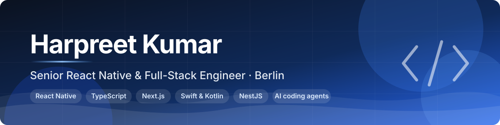

  &nbsp;
  &nbsp;
  

## Hi, I'm Harpreet 👋

I build mobile and web products in **TypeScript end to end**: React Native on the phone, Next.js on the web, Node.js (NestJS) behind them, and **Swift or Kotlin** when React Native is not enough. Six years in mobile, five of them shipping React Native to real users, and one product of my own that I run alone, from the App Store listing to the database.

  

<picture>
  <source media="(prefers-color-scheme: dark)" srcset="https://raw.githubusercontent.com/harpreetkbadhan/harpreetkbadhan/output/github-snake-dark.svg" />
  
</picture>

## What I've built

<table>
<tr>
<td width="50%" valign="top">

### 💸 budgetSum

**Live on the App Store.** A bills-and-payments app I built and run alone: React Native + TypeScript client, NestJS + MongoDB API, RevenueCat / StoreKit subscriptions with server-side entitlements and idempotent webhooks, push notifications, 6 tiers, 8 languages.

`React Native` `TypeScript` `NestJS` `MongoDB` `RevenueCat` `Fastlane` `Sentry`

</td>
<td width="50%" valign="top">

### 🫎 Exercise Moose

**Open source, MIT.** A native macOS menu-bar app: your own avatar drops down for a 30-second desk exercise every 30 minutes, and whenever Claude Code is busy working. Swift (AppKit + SwiftUI), zero dependencies, 146 tests, universal builds in GitHub Actions.

`Swift` `AppKit` `SwiftUI` `Claude Code hooks` `GitHub Actions`

</td>
</tr>
</table>

<a href="https://github.com/harpreetkbadhan/exercise-moose">
<picture>
  <source media="(prefers-color-scheme: dark)" srcset="https://raw.githubusercontent.com/harpreetkbadhan/exercise-moose/main/docs/readme/banner-dark.png">
  
</picture>
</a>

### Client work at List & Sell (private repositories)

## Open source

- **[exercise-moose](https://github.com/harpreetkbadhan/exercise-moose)**: native macOS menu-bar app for desk exercises while Claude Code works &nbsp; 
- **[harpreet-calender](https://www.npmjs.com/package/harpreet-calender)**: React DatePicker with single and range selection, TypeScript types, zero runtime dependencies &nbsp; 
- **[wpforms-node-webhook](https://github.com/harpreetkbadhan/wpforms-node-webhook)**: Node.js + Express webhook receiver that stores WPForms submissions in MongoDB behind a REST API
- **[PremiereNight](https://github.com/harpreetkbadhan/PremiereNight)**: movie discovery app on the TMDb API with React Navigation, Zustand and an AsyncStorage watchlist

## How I work with AI coding agents

## Tech stack

## Let's talk

Based in Berlin, working remotely across Germany and the EU. Open to senior React Native and full-stack roles, and to conversations about AI-assisted engineering workflows.

  &nbsp;
  &nbsp;
  &nbsp;
  

