  &nbsp;
  &nbsp;
  

## Hi, I'm Harpreet 👋

**I ship mobile apps, and I build open-source tools that catch release mistakes before Apple and Google do.**

I build mobile and web products in **TypeScript end to end**: React Native on the phone, Next.js on the web, Node.js (NestJS) behind them, and **Swift or Kotlin** when React Native is not enough. Six years in mobile, five of them shipping React Native to real users, and one product of my own that I run alone, from the App Store listing to the database.

## Merged in

Fixes I got merged in projects I don't own.

| Project | What I fixed |
|---|---|
| [**expo/expo**](https://github.com/expo/expo)  | [#54163](https://github.com/expo/expo/pull/54163) `/_expo/debugger` no longer stops the dev server behind a packager hostname |
| [**app-store-compliance**](https://github.com/mjmirza/app-store-compliance)  | [#2375](https://github.com/mjmirza/app-store-compliance/pull/2375) skip JS and TS test files · [#2376](https://github.com/mjmirza/app-store-compliance/pull/2376) recognise React Native and Expo Sign in with Apple · [#2398](https://github.com/mjmirza/app-store-compliance/pull/2398) name the string that fired, skip CI and e2e text · [#2421](https://github.com/mjmirza/app-store-compliance/pull/2421) ignore hosts quoted in code comments |
| [**nanocoder**](https://github.com/Nano-Collective/nanocoder)  | [#2364](https://github.com/Nano-Collective/nanocoder/pull/2364) placeholder API key only for local providers · [#2367](https://github.com/Nano-Collective/nanocoder/pull/2367) price models by exact id only |
| [**claude-mem**](https://github.com/thedotmack/claude-mem)  | [#6516](https://github.com/thedotmack/claude-mem/pull/6516) a setting that turns off the paid condense call for oversized tool output · [#6518](https://github.com/thedotmack/claude-mem/pull/6518) document what the observer output cap does on each provider |

  

<picture>
  <source media="(prefers-color-scheme: dark)" srcset="https://raw.githubusercontent.com/harpreetkbadhan/harpreetkbadhan/output/github-snake-dark.svg" />
  
</picture>

## Open source

- **[release-lint](https://github.com/harpreetkbadhan/release-lint)**: lints a built iOS or Android app (.ipa, .aab, .apk) for release mistakes before you upload: leaked secrets, staging servers and deep links, the wrong EAS Update channel, debug builds and source maps. CLI, GitHub Action and agent skill, zero dependencies &nbsp;  
- **[refresh-token-rotation](https://github.com/harpreetkbadhan/refresh-token-rotation)**: refresh-token rotation with reuse detection (RFC 9700) for Node.js, plus a fetch client that refreshes once for many parallel 401s &nbsp; 
- **[revenuecat-webhooks](https://github.com/harpreetkbadhan/revenuecat-webhooks)**: typed, verified RevenueCat webhooks for Node.js with a NestJS guard; handles duplicates, out-of-order events and grace periods &nbsp; 
- **[exercise-moose](https://github.com/harpreetkbadhan/exercise-moose)**: native macOS menu-bar app for desk exercises while Claude Code works &nbsp; 
- **[harpreet-calender](https://www.npmjs.com/package/harpreet-calender)**: React DatePicker with single and range selection, TypeScript types, zero runtime dependencies &nbsp; 
- **[wpforms-node-webhook](https://github.com/harpreetkbadhan/wpforms-node-webhook)**: Node.js + Express webhook receiver that stores WPForms submissions in MongoDB behind a REST API
- **[PremiereNight](https://github.com/harpreetkbadhan/PremiereNight)**: movie discovery app on the TMDb API with React Navigation, Zustand and an AsyncStorage watchlist

## What I've built

<table>
<tr>
<td width="50%" valign="top">

### 💸 budgetSum

**Live on the App Store.** A bills-and-payments app I built and run alone: React Native + TypeScript client, NestJS + MongoDB API, RevenueCat / StoreKit subscriptions with server-side entitlements and idempotent webhooks, push notifications, 6 tiers, 8 languages.

`React Native` `TypeScript` `NestJS` `MongoDB` `RevenueCat` `Fastlane` `Sentry`

</td>
<td width="50%" valign="top">

### 🫎 Exercise Moose

**Open source, MIT.** A native macOS menu-bar app: your own avatar drops down for a 30-second desk exercise every 30 minutes, and whenever Claude Code is busy working. Swift (AppKit + SwiftUI), zero dependencies, 146 tests, universal builds in GitHub Actions.

`Swift` `AppKit` `SwiftUI` `Claude Code hooks` `GitHub Actions`

</td>
</tr>
</table>

### Client work at List & Sell (private repositories)

## How I work with AI coding agents

## Tech stack

  &nbsp;
  &nbsp;
  &nbsp;
  

