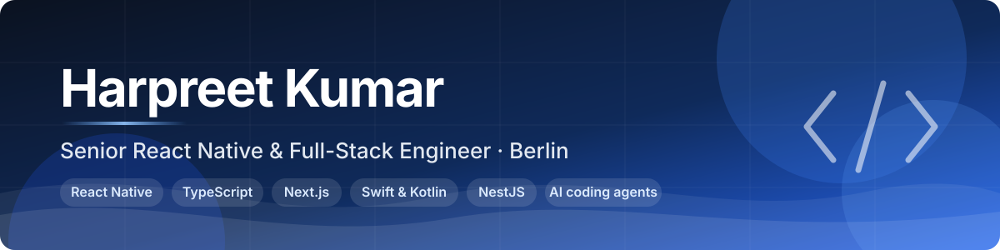

  
  
  

## Hi, I'm Harpreet 👋

I build mobile and web products in **TypeScript end to end**: React Native on the phone, Next.js on the web, Node.js (NestJS) behind them, and **Swift or Kotlin** when React Native is not enough. Six years in mobile, five of them shipping React Native to real users, and one product of my own that I run alone, from the App Store listing to the database.

## What I've built

<table>
<tr>
<td width="50%" valign="top">

### 💸 budgetSum

**Live on the App Store.** A bills-and-payments app I built and run alone: React Native + TypeScript client, NestJS + MongoDB API, RevenueCat / StoreKit subscriptions with server-side entitlements and idempotent webhooks, push notifications, 6 tiers, 8 languages.

`React Native` `TypeScript` `NestJS` `MongoDB` `RevenueCat` `Fastlane` `Sentry`

</td>
<td width="50%" valign="top">

### 🫎 Exercise Moose

**Open source, MIT.** A native macOS menu-bar app: your own avatar drops down for a 30-second desk exercise every 30 minutes, and whenever Claude Code is busy working. Swift (AppKit + SwiftUI), zero dependencies, 146 tests, universal builds in GitHub Actions.

`Swift` `AppKit` `SwiftUI` `Claude Code hooks` `GitHub Actions`

</td>
</tr>
</table>

<a href="https://github.com/harpreetkbadhan/exercise-moose">
<picture>
  <source media="(prefers-color-scheme: dark)" srcset="https://raw.githubusercontent.com/harpreetkbadhan/exercise-moose/main/docs/readme/banner-dark.png">
  
</picture>
</a>

### Client work at List & Sell (private repositories)

| Product | What it does | Stack highlights |
|---|---|---|
| **Wundservice** | Wound-care app for clinicians and patients: offline records at the bedside with sync, conflict handling and retry; health data in encrypted storage | React Native, Swift (Vision) + Kotlin (ML Kit) TurboModule, Keychain / Keystore |
| **GAC Winterdienst** | Field-operations app for winter-service crews: route planning on maps, geo-tagged task completion, works offline and syncs later | React Native, location services, offline-first sync |
| **Flotix** | B2B fleet-expense platform with on-device receipt scanning instead of manual entry | React Native, Supabase (Postgres), ML Kit, Apollo GraphQL |
| **Moverly.io** | CRM for moving companies: Next.js dashboard and React Native app sharing one typed API client | Next.js, Turborepo + pnpm monorepo, Vercel |
| **Barber X** | Booking platform with mobile and desktop kept in sync in real time, with reconnection and state reconciliation | React Native, Electron, WebSockets |

## Open source

| Repository | About | |
|---|---|---|
| [exercise-moose](https://github.com/harpreetkbadhan/exercise-moose) | Native macOS menu-bar app for desk exercises while Claude Code works |   |
| [harpreet-calender](https://www.npmjs.com/package/harpreet-calender) | React DatePicker component with single and range selection, TypeScript types, zero runtime dependencies |  |
| [wpforms-node-webhook](https://github.com/harpreetkbadhan/wpforms-node-webhook) | Node.js + Express webhook receiver that stores WPForms submissions in MongoDB behind a REST API |  |
| [PremiereNight](https://github.com/harpreetkbadhan/PremiereNight) | Movie discovery app on the TMDb API: React Navigation, Zustand, AsyncStorage watchlist |  |

## How I work with AI coding agents

- **Plan first, then small diffs.** A written plan with scope, constraints and acceptance criteria, then the agent implements in reviewable steps, each with its own test run. I read every diff and check the result on a real device before it reaches a PR.
- **Context lives in version control.** Rules files, reusable skills distilled from the codebase's own patterns, and hooks are committed and reviewed like code. Automated review agents check quality and security on every change.
- **Connected, with guardrails.** Claude Code wired via MCP to Figma, Sentry, GitHub, Linear and browser automation; per-project tool allowlists and pre-tool hooks keep destructive commands, credentials and user data out of reach.
- **AI in the product too.** A read-only in-app assistant on the OpenAI and Anthropic APIs with tool calling: the model answers from the customer's data, a person completes the action.

## Tech stack

**Mobile**  
      

**Web**  
     

**Backend & data**  
     

**Cloud, CI & releases**  
     

**Testing**  
    

**AI tooling**  
    

## Let's talk

Based in Berlin, working remotely across Germany and the EU. Open to senior React Native and full-stack roles, and to conversations about AI-assisted engineering workflows.

